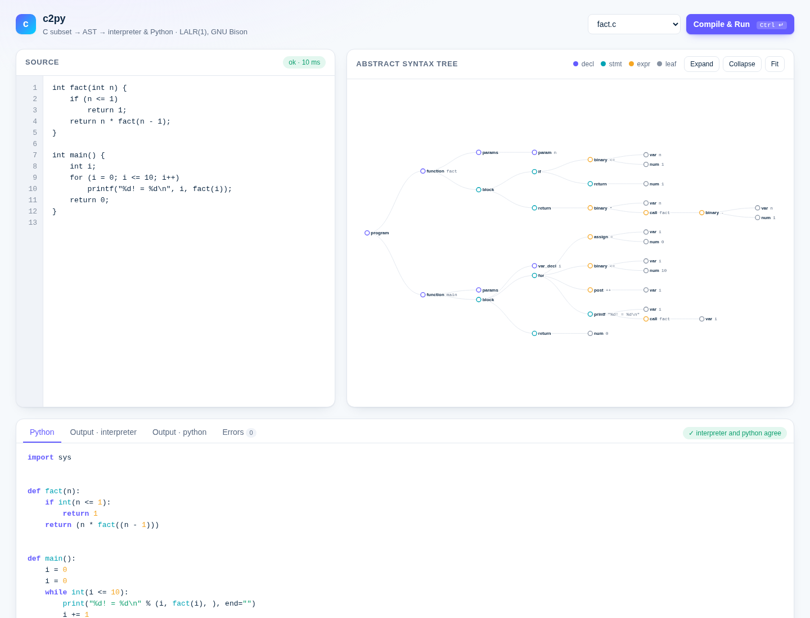

# c2py: an LALR(1) Front End and Dual Back End for a Subset of C

## Abstract

`c2py` is a translator for an imperative subset of C built on a flex scanner and a GNU Bison LALR(1) parser. The parser produces an abstract syntax tree (AST), which after semantic analysis is consumed by two independent back ends: a tree-walking interpreter and a source-to-source code generator targeting Python 3. Each back end acts as an oracle for the other. On every sample program both are checked against the output of the same source compiled with `gcc`. A browser front end visualises the AST interactively with d3.js.

## Source language

| Category | Supported |
|---|---|
| Types | `int` (64-bit), one-dimensional `int` arrays of constant size, `void` as a function return type |
| Declarations | globals, block-scoped locals with initialisers, functions, prototypes (mutual recursion) |
| Statements | `if`/`else`, `while`, `do`–`while`, `for`, `break`, `continue`, `return`, blocks, expression statements |
| Expressions | `+ - * / %`, `== != < <= > >=`, `&& \|\| !` (short-circuit), unary `-`, `= += -= *= /= %=`, prefix and postfix `++ --`, calls, indexing |
| I/O | `printf` with `%d` and `%%` |

Operator precedence and associativity follow ISO C. They are expressed with Bison precedence declarations rather than a stratified grammar, and the dangling `else` is resolved with `%prec`. The grammar is built with `%expect 0`, so it has no unresolved conflicts.

## Architecture

```
source.c ─▶ scanner (flex) ─▶ parser (bison, LALR(1)) ─▶ AST ─▶ semantic analysis
                                                                   ├─▶ interpreter        ─▶ stdout, exit status
                                                                   ├─▶ Python generator   ─▶ out.py ─▶ python3
                                                                   └─▶ JSON               ─▶ d3.js visualiser
```

- **Semantic analysis** maintains a scoped symbol table. It reports all semantic errors in one pass and suppresses cascades from undeclared names. It also assigns each variable a frame slot for the interpreter and a collision-free Python identifier.
- **Interpreter.** Evaluation is direct over the AST, and control flow propagates as an explicit status (`break`/`continue`/`return`). Execution is bounded by a step budget (10⁷) and a call-depth limit (10⁴).
- **Code generator.** C semantics are preserved where Python differs:

| C construct | Python translation |
|---|---|
| `/`, `%` (truncation toward zero) | `_div`, `_mod` helpers |
| relational and logical operators (yield 0/1) | `int(...)` wrapping, `and`/`or` on `bool` |
| assignment and `++`/`--` as expressions | assignment expressions `(x := …)` |
| array element update inside an expression | `_upd`, `_post` helpers (index evaluated once) |
| block scoping and shadowing | renaming (`x`, `x_1`, …) |
| `for` with `continue` | `while` with the step emitted before each `continue` |
| `do`–`while` | `while True` with a trailing conditional `break` |

Helpers are emitted only when referenced.

## Usage

Requirements: `gcc`, `make`, GNU Bison ≥ 3.6, flex, Python ≥ 3.8.

```sh
make                                  # build/c2py
build/c2py examples/fact.c --run      # interpret
build/c2py examples/fact.c --py -     # emit Python to stdout
build/c2py examples/fact.c --ast-json # dump the AST
build/c2py examples/fact.c --trace    # Bison shift/reduce trace on stderr
make conflicts                        # grammar without precedence: conflicts and counterexamples
make web                              # visualiser at http://127.0.0.1:8000/
make test                             # end-to-end test suite
```

Diagnostics follow the `file:line:col: error: message` convention. The exit status is 1 on any compile-time or run-time error. Otherwise it is the value returned by `main`, modulo 256.

## Visualiser

`make web` serves a single-page application on the loopback interface. The page has a source editor, a collapsible and zoomable AST rendered with `d3.tree`, the generated Python with syntax highlighting, and both program outputs, with an indicator of whether they agree. Compile errors are mapped back to source lines. Every asset, including d3 v7.9.0, is served locally. Each compilation and execution runs in a subprocess with a two-second timeout.



## Evaluation

`tests/e2e.py` (standard library only) runs 15 end-to-end tests:
- agreement of the interpreter, the generated Python and `gcc` on every program in `examples/` (exit status included);
- AST well-formedness;
- syntax and semantic diagnostics, including 13 negative cases in `tests/errors/`;
- the absence of error cascades;
- termination of non-terminating programs;
- the parser trace and the conflict demonstration;
- the HTTP API, path-traversal rejection and loopback-only binding;
- rendering of the tree in headless Chromium.

## Limitations

There are no pointers, structures, floating-point types or preprocessor. Integer overflow, which is undefined in C, is not emulated: Python integers are unbounded. Syntax analysis stops at the first error; no `error`-token recovery is attempted.

## Layout

```
src/        lexer.l parser.y ast.[ch] sema.c interp.c pygen.c main.c conflicts.sed
web/        server.py index.html app.js style.css d3.v7.min.js
examples/   sample programs with gcc reference outputs (*.out)
tests/      e2e.py, errors/ (negative cases)
```
